# IMPLEMENTATION ROADMAP: UNIFIED AI JOB SEARCH & APPLICATION CRM

**Version:** 1.0.0  
**Target Completion:** Controlled Phased Rollout  
**Guiding Principle:** Continuous backward compatibility — zero regressions, zero data loss, 100% test pass rate after every phase.  

---

## 1. STRATEGIC IMPLEMENTATION OVERVIEW

The transformation of the existing Job Search Portal into a Unified AI Job Search & Application CRM is executed in **12 sequential, verifiable phases**. Each phase builds upon the existing tested code primitives without overwriting functioning components.

```mermaid
flowchart LR
    P0["Phase 0<br>Audit & Baseline"] --> P1["Phase 1<br>Guided Onboarding"]
    P1 --> P2["Phase 2<br>Multi-Portal Aggregator"]
    P2 --> P3["Phase 3<br>Explainable AI Match"]
    P3 --> P4["Phase 4<br>Similar Jobs Engine"]
    P4 --> P5["Phase 5<br>Company Intelligence"]
    P5 --> P6["Phase 6<br>AI Resume Tailoring"]
    P6 --> P7["Phase 7<br>AI Cover Letters"]
    P7 --> P8["Phase 8<br>15-Stage CRM Pipeline"]
    P8 --> P9["Phase 9<br>Email Bi-Directional"]
    P9 --> P10["Phase 10<br>AI Interview Prep"]
    P10 --> P11["Phase 11<br>Unified SaaS Dashboard"]
    P11 --> P12["Phase 12<br>Production Hardening"]
```

---

## 2. DETAILED PHASE PLANS

### Phase 0: Existing Project Audit & Baseline Architectural Invariants (COMPLETED ✅)
- **Objective:** Complete source file inspection, architecture modeling, test suite verification, and gap analysis.
- **Deliverables:**
  - `PROJECT_AUDIT.md` ✅
  - `PROJECT_ARCHITECTURE.md` ✅
  - `INTEGRATION_MATRIX.md` ✅
  - `PROJECT_STATUS.md` ✅
  - `IMPLEMENTATION_ROADMAP.md` ✅
- **Verification:** 61/61 automated tests passing across Vitest, E2E browser, and Auth suites.

---

### Phase 1: Guided 4-Step Onboarding Wizard & Profile Intelligence
- **Objective:** Transform single registration into a guided 4-step candidate onboarding workflow.
- **Existing Components Reused:**
  - `login.html` authentication & registration forms.
  - `data/candidates.json` candidate profile storage.
  - `scripts/serve-dashboard.js` multipart file upload handlers and session controllers.
- **Components to Build / Enhance:**
  - **Step 1 (Account Creation):** Email, verification state, secure password with strength meter.
  - **Step 2 (Resume Parsing):** Text extraction from uploaded PDF/DOCX resumes (skills taxonomy, employment history, seniority, education) with interactive review and edit modal.
  - **Step 3 (Job Preferences):** Target titles, company preferences, location, mode (remote/hybrid/onsite), minimum salary in INR, employment types.
  - **Step 4 (Integrations):** One-click connection to Gmail, explanation of live portal integrations, and verification of active feeds.
- **Verification Criteria:**
  - Candidate completes onboarding in < 2 minutes.
  - Extracted skills and experience populated into `data/candidates.json`.
  - Resume file safely stored in `data/resumes/`.

---

### Phase 2: Multi-Portal Job Aggregator & Centralized Normalized Job Database
- **Objective:** Build a modular connector architecture unifying listings from 15 sources into a single schema.
- **Existing Components Reused:**
  - `src/sources/mock-source.ts`, `src/sources/external-apis.ts`, `src/sources/live-portal-search.ts`.
  - `src/types/index.ts` job listing types.
- **Components to Build / Enhance:**
  - `src/sources/ats-greenhouse.ts`: Public Greenhouse JSON board adapter.
  - `src/sources/ats-lever.ts`: Public Lever Postings JSON adapter.
  - `src/sources/ats-ashby.ts`: Public Ashby Job Board JSON adapter.
  - `src/sources/url-importer.ts`: User-assisted manual job URL parser (extracts title, company, requirements, location).
  - `src/sources/alert-email-parser.ts`: Job alert email forwarding parser.
  - `src/sources/normalized-db.ts`: In-memory and persisted repository with 15 normalized fields.
- **Verification Criteria:**
  - Greenhouse, Lever, and Ashby jobs fetched and normalized into the unified schema.
  - Manual URL import correctly extracts title, company, and JD.
  - Original 23 jobs remain seamlessly accessible.

---

### Phase 3: Explainable AI Job Matching Engine
- **Objective:** Upgrade the 100-point heuristic into an explainable multi-factor scoring engine with 5 distinct categories.
- **Existing Components Reused:**
  - `src/matching/scorer.ts` (weights for skills, seniority, location, role).
- **Components to Build / Enhance:**
  - `src/matching/explainable-scorer.ts`:
    - Skill match breakdown (matching vs missing skills).
    - Experience gap analysis (years of experience vs requirement).
    - Preparation advice (recommended topics to study).
    - 5 Explicit Categories: `Excellent Match` (85%+), `Recommended` (70-84%), `Similar Opportunities` (60-69%), `Skill Gap Opportunities` (specialized), `Not Recommended` (<50%).
    - "Why this job matches" natural language summary.
    - Zero-single-keyword resilience: Never reject purely on one missing keyword.
- **Verification Criteria:**
  - Unit tests verify explainability objects for 10 diverse job profiles.
  - UI renders match breakdown cards with interactive skill pills.

---

### Phase 4: Similar Job Discovery & Cross-Portal Deduplication
- **Objective:** Enable candidate to discover alternative openings, similar roles, and eliminate duplicate listings across portals.
- **Existing Components Reused:**
  - `src/matching/deduplicator.ts` (normalized string comparisons).
- **Components to Build / Enhance:**
  - `src/matching/similarity-engine.ts`:
    - Same role across different companies.
    - Same role with alternative titles (e.g. "Senior Frontend" vs "Lead UI Developer").
    - Same company alternative openings.
    - Better salary or remote alternative suggestions.
  - Unified saved-job repository in client session and backend store.
- **Verification Criteria:**
  - Clicking "Find Similar" displays ranked similar opportunities.
  - Identical job posted on multiple portals is merged into a single entry with multi-source badges.

---

### Phase 5: Company Intelligence & Research Dossiers
- **Objective:** Provide a deep research profile for every employer in the job discovery feed.
- **Existing Components Reused:**
  - `scripts/generate-battlecards.js` (dossier generator).
  - `data/interview-battlecards/` (existing verified company dossiers).
- **Components to Build / Enhance:**
  - Integrated Company Profile Drawer in `index.html`:
    - Official website & careers portal link.
    - Company size, industry, and headquarters.
    - Technology stack breakdown (Frontend, Backend, Cloud, CI/CD).
    - Verified interview stages (HR screen, Technical Round 1, System Design, Leadership).
    - Sourced date stamp for transparency; zero fabricated company facts.
- **Verification Criteria:**
  - Company dossier loads seamlessly inside job detail drawer.
  - Links to official career portals function accurately.

---

### Phase 6: Truth-Bounded AI Resume Tailoring Engine & Diff Visualizer
- **Objective:** Enable 1-click tailored resume generation with side-by-side diff review and zero fabrication guarantee.
- **Existing Components Reused:**
  - `src/applications/tailor.ts` (tailoring engine).
  - `data/tailored-documents/` storage directory.
- **Components to Build / Enhance:**
  - Side-by-side diff modal in `index.html` comparing original resume with job-tailored resume.
  - Highlighted modifications (re-ordered bullet points, highlighted keywords).
  - Candidate approval button before saving version.
  - Multi-version history (Original, General ATS, Job-Specific).
  - PDF and formatted DOCX export triggers.
  - Strict Rule: Zero fabrication of employers, dates, or skills.
- **Verification Criteria:**
  - Tailored resume matches 100% of candidate's verified background.
  - Diff viewer visualizes exact additions and reordering.
  - Downloads work in both Markdown/PDF and DOCX formats.

---

### Phase 7: AI Cover Letter Generator & Editor
- **Objective:** Generate personalized, professional cover letters tailored to specific openings with in-browser editing.
- **Existing Components Reused:**
  - `src/applications/tailor.ts` (cover letter template logic).
- **Components to Build / Enhance:**
  - Interactive Cover Letter Editor modal in dashboard.
  - Automatic injection of company name, role, matching candidate achievements, and enthusiasm points.
  - Editable text area with character count and professional tone presets.
  - Export to PDF and save against application record in `data/applications.csv`.
- **Verification Criteria:**
  - Generated cover letter accurately references specific company and role details.
  - Candidate edits are persisted to application records.

---

### Phase 8: Unified 15-Stage Application Pipeline CRM
- **Objective:** Expand the 5-stage Kanban board into the complete 15-stage CRM lifecycle.
- **Existing Components Reused:**
  - `src/tracker/persistent-tracker.ts` (CSV persistence).
  - `data/applications.csv` (active 23 applications).
  - `scripts/dashboard-features.js` (Kanban drag-and-drop controller).
- **Components to Build / Enhance:**
  - 15 Lifecycle Stages:
    1. New Job | 2. Interested | 3. Shortlisted | 4. Preparing Application | 5. Resume Ready | 6. Awaiting Approval | 7. Applied | 8. Application Acknowledged | 9. Recruiter Response | 10. Interview Scheduled | 11. Interview Completed | 12. Offer Received | 13. Rejected | 14. Withdrawn | 15. Closed.
  - Pipeline Stage Transition Guard: Duplicate application prevention.
  - Application Detail Modal: Applied date, resume version, cover letter version, notes, follow-up calendar reminder, and history log.
- **Verification Criteria:**
  - Dragging or updating stage updates `data/applications.csv` atomically.
  - 23 existing applications seamlessly mapped to appropriate stages.
  - Duplicate submissions to the same role are blocked with user alert.

---

### Phase 9: Bi-Directional Email Synchronization & Intent Processing
- **Objective:** Connect Gmail and Microsoft Graph to correlate inbound recruiter messages and suggest CRM updates.
- **Existing Components Reused:**
  - `scripts/gmail-reply-detector.js` (OAuth flow, classifier, domain matcher).
  - `data/gmail-config.json` (OAuth configuration).
- **Components to Build / Enhance:**
  - Microsoft Graph OAuth connector (`scripts/ms-graph-detector.js`).
  - Suggested CRM update confirmation banner in dashboard.
  - One-click confirmation modal with email snippet preview.
  - Invariant: Never automatically accept, reject, or apply without explicit user confirmation.
- **Verification Criteria:**
  - Inbound email from verified domain triggers suggested status transition.
  - Confirmation updates CRM stage and writes to application timeline.

---

### Phase 10: AI Interview Preparation Workspace & Mock Simulator
- **Objective:** Provide a dedicated interview readiness workspace for every shortlisted application.
- **Existing Components Reused:**
  - `scripts/generate-battlecards.js` & `data/interview-battlecards/`.
- **Components to Build / Enhance:**
  - Dynamic Interview Preparation Workspace:
    - Company-specific questions.
    - Technical deep-dive questions (JavaScript, CSS, React, Angular, Architecture).
    - Scenario & behavioral questions (STAR format using candidate's verified projects).
    - Salary negotiation guide & market benchmarks.
  - Mock Interview Mode: Timed practice with candidate response recorder.
  - Interview Readiness Score gauge.
- **Verification Criteria:**
  - Questions and sample answers reflect actual candidate projects without fabrication.
  - Mock mode tracks answered questions and updates readiness score.

---

### Phase 11: Unified SaaS Dashboard UI Refinement
- **Objective:** Upgrade the dashboard into an executive 11-section SaaS control center.
- **Existing Components Reused:**
  - `index.html` glassmorphic theme and styling tokens.
- **Components to Build / Enhance:**
  - Top-level Tab Navigation Bar for the 11 Sections:
    1. Overview (Funnel stats, alerts, activity)
    2. Job Discovery (Multi-source feed, filters, search)
    3. My Recommendations (Curated fit feed)
    4. Similar Jobs (Clustered roles)
    5. Companies (Research directory)
    6. My Applications (15-stage Kanban & Table)
    7. Resume Library (Master & tailored resumes)
    8. Cover Letters (Drafting & archive)
    9. Interview Preparation (Battlecards & practice)
    10. Email Activity (Synced threads & logs)
    11. Settings & Integrations (OAuth & preferences)
- **Verification Criteria:**
  - Smooth tab switching without page reload.
  - Consistent layout and responsive mobile design across all 11 sections.

---

### Phase 12: Production Hardening, Verification & Deployment
- **Objective:** Final end-to-end testing, documentation updates, and deployment to Render.
- **Deliverables:**
  - Full automated test suite execution (Vitest + Playwright E2E + Auth).
  - Git commit with author `Ashutosh Kumar <kumar.ashu872@gmail.com>`.
  - Deployment push to Render repository.
  - Final operational handover report.
