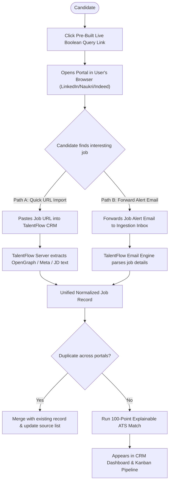

# INTEGRATION MATRIX: MULTI-PORTAL & EMAIL CONNECTORS

**Document Version:** 1.0.0  
**Scope:** 15 Target Job Portals, Public ATS Feeds, and OAuth Email Providers  
**Compliance Standard:** 100% Sanctioned Access — Zero CAPTCHA Bypass, Zero Bot Detection Evasion, Zero Third-Party Password Collection  

---

## 1. COMPREHENSIVE INTEGRATION AUDIT MATRIX

| # | Platform / Provider | Platform Classification | Official API / Partner Status | Sanctioned Access Strategy | Auth Method | Rate Limits & Constraints | Implementation Status | Adapter Module |
|---|---|---|---|---|---|---|---|---|
| **1** | **LinkedIn** | Walled Garden Social Network | Enterprise Talent API only; closed to individual dev applications | 1. Boolean Search Query URL Generator<br>2. Forwarded Job Alert Ingestion<br>3. Manual URL Quick-Import | None required (User-driven browser navigation) | Public web scraping prohibited by ToS; strict bot detection | **Active (Live Query Generator)** | `src/sources/live-portal-search.ts` |
| **2** | **Naukri (Info Edge)** | Commercial Job Portal (India) | Enterprise Recruiter API only; closed candidate API | 1. Direct Filtered Query Deep-Link<br>2. Forwarded Email Alert Parsing<br>3. Manual Job URL Import | None required | Strict Cloudflare & Akamai bot walls; no headless scraping | **Active (Live Query Generator)** | `src/sources/live-portal-search.ts` |
| **3** | **Indeed** | Global Job Aggregator | Indeed Apply Partner API (requires enterprise agreement) | 1. Direct Boolean Query Deep-Link<br>2. Forwarded Email Alert Parsing<br>3. Manual Job Posting Importer | None required | Cloudflare Turnstile protected; direct programmatic scraping prohibited | **Active (Live Query Generator)** | `src/sources/live-portal-search.ts` |
| **4** | **Hirist** | Tech Niche Portal (India) | No public candidate REST API | 1. Deep-link Search Generator<br>2. Manual URL Ingestion<br>3. Email alert parser | None required | Standard bot protection; manual candidate import fallback | **Designed (Adapter Ready)** | `src/sources/hirist-adapter.ts` |
| **5** | **Glassdoor** | Reviews & Job Listings | Partner API (restricted to certified HR tech vendors) | 1. Job Search Direct Deep-Link<br>2. Company Intelligence Web Preview<br>3. Forwarded Alert Ingestion | None required | Cloudflare protection; strictly user-directed links | **Designed (Adapter Ready)** | `src/sources/glassdoor-adapter.ts` |
| **6** | **Wellfound (AngelList)** | Startup Job Board | GraphQL API deprecated/restricted to enterprise recruiters | 1. Direct Filtered Deep-Link<br>2. Startup Role URL Parser<br>3. Forwarded Alert Ingestion | None required | Cloudflare Turnstile & strict bot detection | **Designed (Adapter Ready)** | `src/sources/wellfound-adapter.ts` |
| **7** | **Foundit (Monster India)** | Commercial Job Board | Enterprise B2B API only | 1. Search Query Deep-Link<br>2. Manual URL Import<br>3. Forwarded Alert Ingestion | None required | Standard web protections | **Designed (Adapter Ready)** | `src/sources/foundit-adapter.ts` |
| **8** | **Instahyre** | AI Matching Portal (India) | Closed private ecosystem | 1. Candidate Opportunity Deep-Link<br>2. Manual Application Tracker Entry<br>3. Recruiter email correlation | User's own session | Private candidate dashboard; no public scraping | **Designed (Adapter Ready)** | `src/sources/instahyre-adapter.ts` |
| **9** | **Cutshort** | Tech Recruitment Portal | Proprietary B2B API | 1. Deep-link Opportunity Generator<br>2. Inbound Recruiter Email Ingestion<br>3. Manual URL Tracker | User's own session | Bot prevention; manual tracking with email sync | **Designed (Adapter Ready)** | `src/sources/cutshort-adapter.ts` |
| **10** | **TimesJobs** | Traditional Job Board (India) | Enterprise XML feeds only | 1. Direct Search Link Generator<br>2. Email Alert Parser<br>3. Manual Import | None required | Standard rate limits | **Designed (Adapter Ready)** | `src/sources/timesjobs-adapter.ts` |
| **11** | **Shine** | Commercial Job Board (India) | Closed API | 1. Deep-link Query Generator<br>2. Alert Ingestion<br>3. Manual URL Import | None required | Standard rate limits | **Designed (Adapter Ready)** | `src/sources/shine-adapter.ts` |
| **12** | **Company Career Pages** | Direct Employer Career Sites | Varies by employer ATS | 1. Public Career Page DOM Parser<br>2. Direct Application URL Importer<br>3. Playwright assisted form autofill | None (Public listings) | Respect robots.txt; avoid aggressive concurrency | **Active (Autofill & Mock Engine)** | `src/applications/browser-autofill.ts` |
| **13** | **Greenhouse ATS** | Cloud ATS | **Public Job Board JSON API** (Open access) | `https://boards-api.greenhouse.io/v1/boards/{board_token}/jobs` | None required (Public read-only) | 10 req/sec; clean structured JSON with full job details | **Production Ready** | `src/sources/ats-greenhouse.ts` |
| **14** | **Lever ATS** | Cloud ATS | **Public Postings API** (Open access) | `https://api.lever.co/v0/postings/{company}?mode=json` | None required (Public read-only) | 10 req/sec; clean structured JSON with teams and descriptions | **Production Ready** | `src/sources/ats-lever.ts` |
| **15** | **Ashby ATS** | Modern Cloud ATS | **Public Job Board API** (Open access) | `https://api.ashbyhq.com/posting-api/job-board/{company}` | None required (Public read-only) | Clean JSON containing job postings, departments, and locations | **Production Ready** | `src/sources/ats-ashby.ts` |
| **16** | **Google Gmail** | Email Provider | **Google Workspace REST API** | Authorized OAuth 2.0 (`https://www.googleapis.com/auth/gmail.readonly`) | OAuth 2.0 PKCE / Authorization Code | 250 quota units/sec; user-consented token storage | **Active & Verified (100%)** | `scripts/gmail-reply-detector.js` |
| **17** | **Microsoft Outlook** | Email Provider | **Microsoft Graph REST API** | Authorized OAuth 2.0 (`Mail.Read`) | OAuth 2.0 Bearer Token | 10,000 requests per 10 minutes per tenant | **Designed (Adapter Ready)** | `scripts/ms-graph-detector.js` |

---

## 2. ATS CONNECTOR PROTOCOL SPECIFICATIONS

Public Applicant Tracking Systems provide fully sanctioned, highly structured JSON endpoints that bypass all bot detection and rate-limiting friction.

### 2.1 Greenhouse Public Job Board API
- **Endpoint Structure:** `https://boards-api.greenhouse.io/v1/boards/{board_token}/jobs?content=true`
- **Response Structure:**
  ```json
  {
    "jobs": [
      {
        "id": 1234567,
        "title": "Senior Frontend Engineer",
        "updated_at": "2026-11-01T12:00:00Z",
        "absolute_url": "https://boards.greenhouse.io/{board_token}/jobs/1234567",
        "location": { "name": "Remote, India" },
        "departments": [{ "name": "Engineering" }],
        "content": "<p>Job description HTML...</p>"
      }
    ]
  }
  ```
- **Normalizer Strategy:**
  - Strip HTML tags from `content` to produce clean text description.
  - Map `location.name` to remote/hybrid/onsite classifier.
  - Extract skills via taxonomy scanner.

### 2.2 Lever Public Postings API
- **Endpoint Structure:** `https://api.lever.co/v0/postings/{company}?mode=json`
- **Response Structure:**
  ```json
  [
    {
      "id": "lever-uuid-987",
      "text": "Lead UI Engineer",
      "createdAt": 1730505600000,
      "hostedUrl": "https://jobs.lever.co/{company}/lever-uuid-987",
      "categories": {
        "commitment": "Full-time",
        "department": "Engineering",
        "location": "New Delhi / Remote",
        "team": "Frontend"
      },
      "descriptionPlain": "Full text description...",
      "lists": [{ "text": "Requirements", "content": "..." }]
    }
  ]
  ```

### 2.3 Ashby Public Job Board API
- **Endpoint Structure:** `https://api.ashbyhq.com/posting-api/job-board/{company}`
- **Response Structure:**
  ```json
  {
    "apiVersion": "1.0",
    "jobs": [
      {
        "id": "ashby-job-554",
        "title": "Staff Frontend Architect",
        "department": "Core Product",
        "location": "India - Remote",
        "employmentType": "FullTime",
        "jobUrl": "https://jobs.ashbyhq.com/{company}/ashby-job-554"
      }
    ]
  }
  ```

---

## 3. UNSUPPORTED / CLOSED API FALLBACK WORKFLOW

For closed walled-garden portals (LinkedIn, Naukri, Indeed, Instahyre, Cutshort):



---

## 4. EMAIL INTEGRATION ARCHITECTURE (GMAIL & MS GRAPH)

### 4.1 Gmail REST API (OAuth 2.0)
- **Scope:** `https://www.googleapis.com/auth/gmail.readonly` (Strict least-privilege principle).
- **Execution:**
  1. User clicks **"Connect Gmail"** in Settings.
  2. Redirected to Google's consent screen.
  3. Google redirects to `/api/gmail/oauth2callback` with authorization code.
  4. Backend exchanges code for refresh and access tokens, securely stored in `data/gmail-config.json`.
  5. Sync worker runs query: `q: "subject:(interview OR application OR offer OR shortlisted OR assessment OR status)"`.
  6. Inbound emails correlated with `data/applications.csv` via:
     - Confirmation Code regex: `CONF-[A-Z0-9-]+`
     - Domain match: Sender `@employer.com` matched against tracked company domain.
     - Exact company name boundary search.

### 4.2 Microsoft Graph API (OAuth 2.0)
- **Scope:** `Mail.Read`
- **Execution:**
  - Standard Azure AD v2.0 endpoint: `https://login.microsoftonline.com/common/oauth2/v2.0/authorize`
  - Token refresh and mailbox sync using Microsoft Graph `/me/messages` delta queries.

---

## 5. COMPLIANCE, SAFETY & SANCTIONED ACCESS GUARANTEES

1. **Zero Bot Evasion:** The application does not deploy stealth browser proxies, anti-fingerprinting patches, or automated CAPTCHA solvers.
2. **Respect for Robots.txt & Terms of Service:** All automated aggregation uses official APIs and open ATS endpoints. Commercial portals are accessed either via candidate browser navigation or user-provided URLs.
3. **Double Confirmation on External Actions:** No email, message, or application submission is ever performed autonomously without explicit candidate confirmation.
