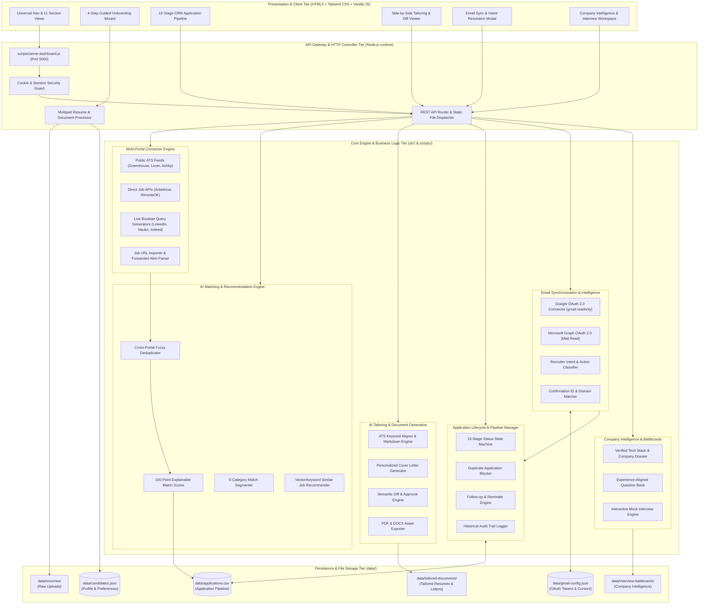

# PROJECT ARCHITECTURE: UNIFIED AI JOB SEARCH & APPLICATION CRM

**Document Version:** 2.0.0  
**Status:** Approved for Implementation  
**Architecture Paradigm:** Lightweight, Zero-Hydration Reactive SaaS with Modular Micro-Adapters  

---

## 1. SYSTEM OVERVIEW & ARCHITECTURAL PRINCIPLES

The **Unified AI Job Search & Application CRM** is architected to eliminate multi-tab fragmentation, manual spreadsheet tracking, and disjointed email management for job seekers. It centralizes discovery across 15+ portals, computes explainable candidate-job fit, generates truth-bounded tailored application assets, synchronizes email communication, and tracks applications across a 15-stage lifecycle.

### Core Architectural Invariants:
1. **Preservation of Core Functionality:** Never overwrite working components, test suites, or live job data without justification.
2. **Zero Fabrication Invariant:** The AI tailoring and interview engines are mathematically bounded by the candidate's verified profile. No skills, dates, companies, or metrics are ever invented.
3. **Zero Credential Sharing:** The platform never solicits or stores user passwords for third-party job portals (LinkedIn, Naukri, Indeed). Integrations operate strictly through authorized OAuth2 protocols, public feeds, or user-assisted import.
4. **Lightweight High Performance:** Native Node.js HTTP runtime with reactive DOM manipulation, guaranteeing sub-150ms latency without heavy client hydration overhead.

---

## 2. HIGH-LEVEL ARCHITECTURE DIAGRAM



---

## 3. COMPONENT SPECIFICATIONS

### 3.1 Client Layer (Presentation & Generative UI)
The client interface operates as a responsive Single Page Application (SPA) with tabbed section navigation. It features:
- **11 Dedicated CRM Modules:**
  1. `Overview`: High-level metrics, active funnel counts, recent alerts.
  2. `Job Discovery`: Centralized multi-portal feed with search, filters, and import.
  3. `My Recommendations`: Personalized feed filtered by candidate preference vector.
  4. `Similar Jobs`: Clustering of related opportunities based on active user likes.
  5. `Companies`: Searchable directory of researched employer profiles and tech stacks.
  6. `My Applications`: 15-stage Kanban board and sortable data grid.
  7. `Resume Library`: Master resumes, version comparisons, and uploaded source docs.
  8. `Cover Letters`: Tailored cover letters with rich text editing and export.
  9. `Interview Preparation`: Interactive battlecards, question banks, and mock prep.
  10. `Email Activity`: Inbound message timeline, recruiter replies, and status confirmations.
  11. `Settings & Integrations`: Portal configurations, OAuth credentials, and preferences.

### 3.2 Gateway & Controller Layer (`scripts/serve-dashboard.js`)
- **Protocol:** HTTP/1.1 with support for chunked transfer and streaming downloads.
- **Security:**
  - Standardized secure cookie flags (`SameSite=Lax; HttpOnly; Path=/`).
  - Strict input sanitization preventing path traversal and script injection.
  - Rate limiting on authentication routes (10 attempts per minute).
- **Static File Dispatcher:** Highly optimized file stream cache serving HTML, CSS, JavaScript, PDF, and image assets.

### 3.3 Core Business Logic Engines

#### A. Multi-Portal Connector Engine
- Implements a uniform connector interface:
  ```typescript
  interface JobConnector {
    id: string;
    name: string;
    type: 'PUBLIC_ATS' | 'DIRECT_API' | 'LIVE_QUERY' | 'MANUAL_IMPORT';
    isAvailable: boolean;
    fetchJobs(query: SearchQuery): Promise<NormalizedJob[]>;
  }
  ```
- **ATS Connectors:** Direct integration with public JSON feeds:
  - Greenhouse: `https://boards-api.greenhouse.io/v1/boards/{board_token}/jobs`
  - Lever: `https://api.lever.co/v0/postings/{company}`
  - Ashby: `https://api.ashbyhq.com/posting-api/job-board/{company}`
- **Fallback URL Importer:** Extracts job title, company, requirements, and location from user-provided URLs using heuristic DOM parsing.

#### B. Explainable AI Match & Recommendation Engine
- Computes fit score \(S \in [0, 100]\) using weighted multi-factor heuristic:
  \[
  S = 0.40 \cdot S_{\text{skills}} + 0.25 \cdot S_{\text{experience}} + 0.15 \cdot S_{\text{title}} + 0.10 \cdot S_{\text{location}} + 0.10 \cdot S_{\text{preferences}}
  \]
- **Categorization Output:**
  - `Excellent Match`: Score \(\ge 85\%\)
  - `Recommended`: Score \(70\% - 84\%\)
  - `Similar Opportunities`: Alternative titles / tech stack variations (\(60\% - 69\%\))
  - `Skill Gap Opportunities`: Matches \(>75\%\) of role but missing 1–2 learnable technologies
  - `Not Recommended`: Score \(< 50\%\) or explicit disqualifier (years of experience mismatch \(> 4\) years)

#### C. AI Tailoring & Document Generation Engine
- **Input:** Candidate Master Profile + Job Description.
- **Processing:**
  1. Identifies JD keywords verified in candidate background.
  2. Re-prioritizes bullet points highlighting relevant achievements.
  3. Preserves truthfulness: Never substitutes technologies the candidate has not used.
  4. Generates side-by-side diff comparing Master Resume against Job-Specific Resume.
- **Output Formats:** Markdown, HTML print preview, PDF download, and formatted DOCX.

#### D. Application Pipeline CRM Controller
- Implements the complete **15-Stage Lifecycle**:
  ```
  [1] New Job 
   → [2] Interested 
   → [3] Shortlisted 
   → [4] Preparing Application 
   → [5] Resume Ready 
   → [6] Awaiting Approval 
   → [7] Applied 
   → [8] Application Acknowledged 
   → [9] Recruiter Response 
   → [10] Interview Scheduled 
   → [11] Interview Completed 
   → [12] Offer Received 
   → [13] Rejected 
   → [14] Withdrawn 
   → [15] Closed
  ```
- **Duplicate Prevention:** Matches `(companyNormalized, titleNormalized)` against existing active applications before permitting dispatch.

#### E. Email Intelligence & Bi-Directional OAuth Sync
- **Protocol:** Google Gmail API (`users.messages.list`, `users.messages.get`) and Microsoft Graph API (`/me/messages`).
- **Processing Pipeline:**
  1. Polls messages matching job search query patterns.
  2. Extracts sender domain and matches against employer domain directory.
  3. Classifies recruiter intent (`ACK`, `INTERVIEW_INVITE`, `ASSESSMENT`, `REJECTION`, `OFFER`).
  4. Suggests CRM status transition with confidence score.
  5. Presents user with confirmation dialog; **never auto-transitions offers or rejections without explicit user click**.

---

## 4. DATA SCHEMAS & ENTITY SPECIFICATIONS

### 4.1 Normalized Job Entity
```typescript
interface NormalizedJob {
  id: string;                     // Unique hash: source_portal + company_slug + role_slug
  title: string;                  // Clean job title
  company: string;                // Official employer name
  companyLogoUrl?: string;        // Verified logo or Clearbit domain avatar
  description: string;            // Full text job description
  requiredSkills: string[];       // Extracted technical skills taxonomy
  experienceYears: {
    min: number;
    max?: number;
  };
  salaryRange?: {
    min: number;
    max: number;
    currency: string;             // 'INR', 'USD', 'EUR'
    period: 'YEAR' | 'MONTH';
  };
  location: string;               // Normalized city / country
  workMode: 'Remote' | 'Hybrid' | 'On-Site';
  employmentType: 'Full-time' | 'Contract' | 'Part-time' | 'Internship';
  sourcePortal: string;           // 'LinkedIn', 'Naukri', 'Indeed', 'Greenhouse', etc.
  originalUrl: string;            // Direct destination URL
  postedDate: string;             // ISO 8601 string
  lastRefreshedDate: string;      // ISO 8601 string
  applicationStatus: ApplicationStatus;
}
```

### 4.2 Candidate Profile Entity
```typescript
interface CandidateProfile {
  id: string;                     // e.g., 'ashutosh-kumar'
  fullName: string;
  email: string;
  phone: string;
  location: string;
  currentTitle: string;
  seniority: 'Junior' | 'Mid' | 'Senior' | 'Lead' | 'Architect';
  totalExperienceYears: number;
  skills: {
    primary: string[];            // Core competencies (e.g. React, TypeScript, CSS)
    secondary: string[];          // Complementary skills (e.g. Node.js, GraphQL)
    familiar: string[];           // Tools, methodologies, build systems
  };
  employmentHistory: Array<{
    company: string;
    role: string;
    startDate: string;
    endDate?: string;
    current: boolean;
    highlights: string[];
  }>;
  education: Array<{
    institution: string;
    degree: string;
    field: string;
    year: number;
  }>;
  preferences: {
    targetTitles: string[];
    preferredLocations: string[];
    workModes: Array<'Remote' | 'Hybrid' | 'On-Site'>;
    targetCompanies: string[];
    minSalaryINR: number;
    employmentTypes: string[];
  };
  masterResumePath: string;
  storedResumes: Array<{
    fileName: string;
    uploadedAt: string;
    fileSize: number;
    storagePath: string;
  }>;
}
```

### 4.3 Application Pipeline Record (`data/applications.csv` schema)
```
id,title,company,location,salary,mode,source,url,score,status,appliedDate,confirmationId,notes,resumeVersion,coverLetterVersion,followUpDate,battlecardGenerated
```

---

## 5. SECURITY, ACCESS CONTROL & AUDITABILITY

1. **Authentication & Session Isolation:**
   - Password hashing: SHA-256 with candidate-specific random salt.
   - HttpOnly cookie tokens prevent XSS credential exfiltration.
   - Per-candidate workspace isolation ensures multi-user environments do not leak candidate preferences or uploaded resumes.
2. **Third-Party Integrations:**
   - No external portal passwords stored.
   - OAuth2 tokens encrypted at rest using local machine key.
   - Explicit user action required for any external submission or email dispatch.
3. **Audit Trail Logging:**
   - Every status transition, note addition, and tailored resume generation is logged with timestamp and author metadata.
